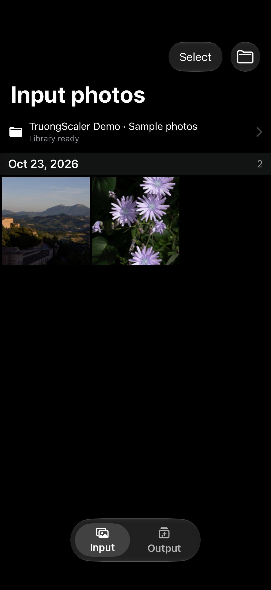
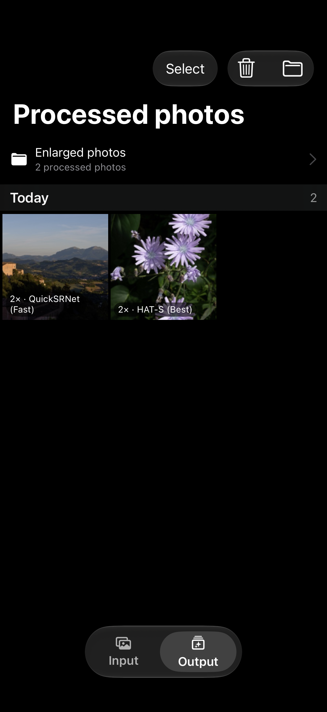
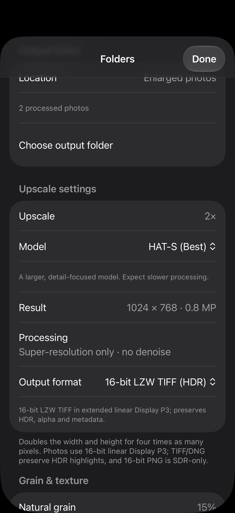

<div align="center">


# TruongScaler

Native 2× iPhone photo enlargement with local Core ML models, HDR-aware exports and a before/after library in Files.

[Download latest IPA](https://github.com/iant4093/TruongScaler/releases/latest/download/TruongScaler.ipa) · [Releases](https://github.com/iant4093/TruongScaler/releases) · [Build status](https://github.com/iant4093/TruongScaler/actions) · [Report an issue](https://github.com/iant4093/TruongScaler/issues)

[](https://github.com/iant4093/TruongScaler/releases/latest/download/TruongScaler.ipa)


[](https://github.com/iant4093/TruongScaler/actions/workflows/ci.yml)

</div>

---

TruongScaler's model choices on this feature branch are **QuickSRNet (Fast)** by default, **EDSR (Balanced)** and **HAT-S (Best)**. Every new job uses native **2×**, with denoise off. Choose an input folder and a separate output folder in Files; saved results retain their model, processing history and frozen original for before/after comparison when reopened. Inference uses trained Core ML models and Apple frameworks, without a remote processing service.

Build 1008 remains the separate validated two-model release baseline. This branch integrates **three choices and six compiled variants**, with 192 and 256 input shapes for each model. Its HAT-S reference, runtime and application checks are recorded separately in [validation and limits](docs/VALIDATION.md). The tier names describe the intended time/detail tradeoff; HAT-S phone speed, image quality and accelerator placement have not been measured.

## Screenshots

Current screenshots show actual production SwiftUI/UIKit screens captured in an iOS Simulator at 1206 × 2622, using temporary libraries and CC0 photo fixtures. The viewer shows a saved native 2× HAT-S result reopened through its portable record; settings show HAT-S selected for the next job. Screens illustrate the interface; they do not establish physical-phone performance or image-quality superiority. Photography credits, source links and capture details are in [screenshot provenance](docs/screenshots/provenance.json).

<table>
  <tr>
    <td width="50%" valign="top">
      
      <p align="center"><sub><b>Input library</b> · browse photos from a chosen Files folder</sub></p>
    </td>
    <td width="50%" valign="top">
      
      <p align="center"><sub><b>Before and after</b> · compare the saved original with its 2× result</sub></p>
    </td>
  </tr>
  <tr>
    <td width="50%" valign="top">
      
      <p align="center"><sub><b>Output library</b> · reopen, share and manage saved results</sub></p>
    </td>
    <td width="50%" valign="top">
      
      <p align="center"><sub><b>Processing settings</b> · choose the model, export format and grain retention</sub></p>
    </td>
  </tr>
</table>

## Features

**Processing**

- Native 2× super-resolution with QuickSRNet-Large, EDSR-baseline and HAT-S, with 192 and 256 input memory tiers for each; six variants are bundled
- Local Core ML inference with required trained weights, pinned provenance, SHA-256 verification and preserved BSD/MIT/Apache-2.0 model notices
- Recursive input folders containing supported photos and RAWs, including loose files outside a camera-app library
- Disk-backed canvases, overlapping tiles and durable checkpoint/journal recovery for interrupted work
- Stop, resumable jobs and batch progress that includes saving each photo
- Linear Display P3 processing, preserved HDR headroom and alpha, plus optional source-derived grain retention
- Rendered Linear DNG, half-float LZW TIFF, 16-bit SDR PNG, runtime-verified HDR HEIC and SDR JPEG export

**Library**

- Separate Input and Output collections with folder bookmarks, selection and swipe navigation
- Zoomable before/after viewing that retains the result's recorded model and actual dimensions
- Automatic portable result records and deduplicated, byte-frozen originals for persistent comparisons
- Small browsing previews that preserve full-resolution processing and exports
- Sharing of saved result bytes without another export, plus an explicit Save Original to Photos action
- Recoverable Recently Deleted, batch Restore and confirmed permanent deletion for Output photos
- Bounded processing history and supported EXIF/GPS metadata carried through exports

RAW decoding depends on the installed Apple runtime and camera format. **Real Canon EOS R7 CR3 files have not been exercised**; extension recognition does not establish camera compatibility. Gain-map HDR raster inputs are refused when native decoding returns only their SDR base; linear DNG/TIFF provide separate HDR paths. PNG is SDR-only, and HDR HEIC succeeds only after its encoded pixels pass runtime verification. Phone speed, physical image quality, ANE placement and background scheduling remain unmeasured; see [validation and limits](docs/VALIDATION.md).

## Install

1. Download [the latest IPA](https://github.com/iant4093/TruongScaler/releases/latest/download/TruongScaler.ipa).
2. Import it into your preferred sideloading/signing tool and sign it with your own Apple account.
3. Choose an input folder of supported photos and a separate writable output folder in Files.

Release IPAs are **unsigned**. They need signing before installation and are not App Store/TestFlight packages. GitHub does not store an Apple signing identity. The download button points to the most recent successfully published release once one is available.

Use retained folders outside the app's own container if you want them to survive removing the app. Keep the output folder's `originals/`, `metadata/` and `comparison-originals/` together to preserve recorded results and before/after. Frozen originals consume additional storage and are shared across results; deleting one output does not automatically delete its archived original. Recently Deleted is never automatically emptied. Files-provider behavior and available working space depend on the device and provider.

## Tech stack

| Area | Technologies |
|---|---|
| Inference | Core ML; QuickSRNet-Large, EDSR-baseline and HAT-S models |
| Interface | SwiftUI, UIKit, Liquid Glass, tiled image viewing |
| Imaging | Metal, Core Image, Image I/O, Core Graphics, linear Display P3 |
| Storage and export | Security-scoped Files access, coordinated operations, POSIX mmap, durable journals, streamed C++ Linear DNG writer |
| Quality | SwiftLint, Swift 6 strict concurrency, warnings as errors, XCTest, Xcode static analysis; CodeQL for workflows |
| Delivery | GitHub Actions, unsigned arm64 IPA, SHA-256 checksums, build attestations, external app/widget dSYM |

Models and their license notices ship in the app. Python, PyTorch and conversion dependencies are developer tools only. Conversion and reference-parity details are in [the model guide](docs/13_TRAINED_MODEL_INTEGRATION.md).

## Build locally

Requires a Mac with **Xcode 27**, its iOS SDK and an iOS 27+ iPhone 17 Simulator runtime for native tests. The tracked Xcode project and local Swift package require no third-party runtime package installation. Python 3 runs the build/resource audits.

Open `TruongScaler.xcodeproj` and select the `TruongScalerApp` scheme. For your own on-device development, configure your development team under Signing & Capabilities. Scripted builds below remain unsigned and do not install or run anything on a phone.

```bash
# Unsigned Debug and Release device app/widget builds and resource audits
bash scripts/build.sh

# Unsigned Simulator app/widget build and resource audit
bash scripts/build.sh simulator

# Validate and package the Release device app and matching crash symbols
bash scripts/package-ipa.sh
```

Local packages appear under `build/ipa/` as `TruongScaler.ipa`, `TruongScaler.dSYM.zip` and `SHA256SUMS`. The packager verifies unsigned bundles, Mach-O device platform, arm64 architecture, matching app/widget crash symbols and ZIP integrity. Release executables are optimized and stripped; dSYM files stay outside the installed app. Builds use two jobs and `build/DerivedData` by default; `TRUONGSCALER_BUILD_JOBS` and `TRUONGSCALER_DERIVED_DATA` override those values. See [development and architecture](docs/DEVELOPMENT.md) for the pipeline and storage/export contracts.

## Tests

```bash
# Pinned SwiftLint, with checksum verification on download
bash scripts/lint.sh

# Mac package regressions, trained references, packaging fixtures and asset hashes
bash scripts/verify-logic.sh

# Actual package and hosted UIKit execution on an iPhone 17 Simulator, iOS 27+
bash scripts/test.sh native
```

The native runner requires an available iPhone 17 Simulator on iOS 27 or later and fails if it cannot find one. It executes the package suites and app-hosted viewer/share tests; it does not replace native execution with a Mac build. Logs, quality outputs and result bundles are written under the ignored `build/` directory. Heavy checks run serially with bounded process-descendant memory. [The validation record](docs/VALIDATION.md) distinguishes historical executed passes from unmeasured device behavior.

## CI and releases

Pull requests and pushes to `main` run four gates:

1. Workflow lint/security checks with actionlint and zizmor, Gitleaks secret scanning and CodeQL GitHub Actions analysis.
2. SwiftLint correctness checks, Mac package/reference regressions, metadata fixtures and model/checkpoint verification.
3. Actual native package and hosted UIKit tests on an iPhone 17 Simulator with iOS 27+.
4. Unsigned Debug/Release device and Simulator app/widget builds, strict concurrency, warnings as errors, Xcode static analysis, resource audits and IPA/crash-symbol packaging.

After all gates pass, pushes to `main` publish a GitHub Release containing `TruongScaler.ipa`, `SHA256SUMS` and `TruongScaler.dSYM.zip`. The workflow can also be run manually on `main`. Pull requests never publish, and an older run does not replace the release for a newer main commit. Release artifacts receive GitHub build attestations; publishing uses the workflow's scoped GitHub token, with no Apple certificate or provisioning secret.

CodeQL analyzes the GitHub Actions workflows; the app is checked by the native compiler, SwiftLint, tests and Xcode analysis. Actions are pinned to commit SHAs, and Dependabot checks them weekly. Native jobs use the `xcode-27` runner. Build/test artifacts have short retention; generated output and local credentials are git-ignored. The workflow configuration describes these gates; successful hosted execution is established by the linked [build status](https://github.com/iant4093/TruongScaler/actions).

## Repository layout

```text
.
├── Sources/                Swift package imaging, storage, background and UI modules
├── Targets/                iOS app, bundled trained models and Live Activity widget
├── Tests/                  Package regressions, fixtures and app-hosted UIKit tests
├── TruongScaler.xcodeproj/ Tracked native project and shared schemes
├── Package.swift           Local Swift package manifest
├── project.yml             XcodeGen project definition
├── ModelConversionTools/   Pinned converters, official sources and checkpoints
├── scripts/                Lint, test, build, validation and packaging commands
├── docs/                   Maintained guides, validation and screenshot provenance
├── .github/                CI/release workflow and dependency-update configuration
├── .swiftlint.yml          Focused correctness rules
└── README.md
```
